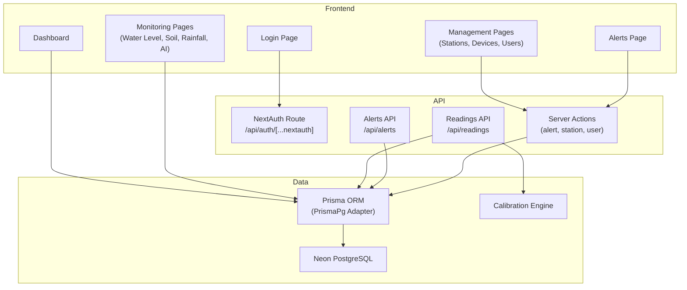

# Codebase Review — NYAWIT Soil Monitoring System

> **Project**: Peatland (gambut) water table & soil monitoring dashboard  
> **Stack**: Next.js 16.2.4 · React 19 · Prisma 7 + PrismaPg · NextAuth v5 · Tailwind v4 · shadcn/ui · Recharts · Neon PostgreSQL  
> **Reviewed**: 2026-05-29

---

## Architecture Overview



**Role-based access**: Two roles — `SUPER_ADMIN` (all stations) and `ADMIN_LOCATION` (single station via `stationId` FK).

---

## 🔴 Critical Issues

### 1. Exposed Secrets in `.env` (committed to repo)

[.env](file:///d:/School/Project/Soil_Monitoring_System/.env) contains the live **Neon database connection string** and **AUTH_SECRET**. Although `.gitignore` has `.env*`, the file currently exists in the working tree — verify it's not in git history.

> [!CAUTION]
> If these secrets were ever committed, they must be **rotated immediately**: change the Neon password, regenerate `AUTH_SECRET`, and use `git filter-branch` or BFG to purge history.

### 2. Readings API Has No Authentication

[route.ts](file:///d:/School/Project/Soil_Monitoring_System/src/app/api/readings/route.ts) — both `POST` (ingest) and `GET` (fetch) endpoints have **zero auth checks**. Anyone can:
- **Inject fake sensor data** via `POST /api/readings`
- **Dump all readings** via `GET /api/readings`

```diff
 // POST /api/readings
 export async function POST(request: NextRequest) {
+  // TODO: Authenticate device (API key, device token, etc.)
+  const apiKey = request.headers.get("x-api-key");
+  if (!apiKey || apiKey !== process.env.DEVICE_API_KEY) {
+    return NextResponse.json({ error: "Unauthorized" }, { status: 401 });
+  }
   ...
```

### 3. Alerts API GET Has No Authentication

[alerts/route.ts](file:///d:/School/Project/Soil_Monitoring_System/src/app/api/alerts/route.ts) — `GET /api/alerts` is unauthenticated and has no station-level scoping. Any user can fetch all alerts for any station.

### 4. Auth Type Augmentation Conflict

[auth.ts](file:///d:/School/Project/Soil_Monitoring_System/src/lib/auth.ts#L89-L108) declares `module "next-auth"` **twice** — once for `Session` (L89) and once for `JWT` (L102). The second declaration may silently overwrite or conflict with the first. The `JWT` interface should be declared inside `declare module "@auth/core/jwt"` per Auth.js v5 docs.

```diff
-declare module "next-auth" {
-  interface JWT {
+declare module "@auth/core/jwt" {
+  interface JWT {
```

---

## 🟠 High Severity

### 5. Middleware Uses Cookie Name, Not Auth Verification

[middleware.ts](file:///d:/School/Project/Soil_Monitoring_System/src/middleware.ts#L9) checks for a cookie named `authjs.session-token` but doesn't verify its validity. A user could craft a cookie with any value and bypass the redirect — they wouldn't get a real session, but it bypasses the login-redirect gate. In production with HTTPS, the cookie name becomes `__Secure-authjs.session-token`.

> [!WARNING]
> Import `auth` from your auth config and use `const session = await auth()` in middleware for proper JWT validation. The current approach will break with HTTPS/secure cookies.

### 6. `calibrateAllReadings` Coerces `null` to `0`

[calibration.ts:L179-L184](file:///d:/School/Project/Soil_Monitoring_System/src/lib/calibration.ts#L179-L184) — When a raw value is `null`, it falls back to `0` and calibrates it, producing a false calibrated value instead of `null`. A sensor that didn't report moisture shouldn't show `0%` moisture.

```diff
-  waterLevel: applyCalibration(raw.rawWaterLevel ?? 0, formulas.waterLevel, params),
+  waterLevel: raw.rawWaterLevel != null
+    ? applyCalibration(raw.rawWaterLevel, formulas.waterLevel, params)
+    : null,
```

### 7. No Rate Limiting on Readings Ingestion

`POST /api/readings` has no rate limiting. A compromised or misconfigured device could flood the database with thousands of rows per second.

### 8. Empty Directories / Incomplete Features

| Path | Status |
|------|--------|
| `src/app/dashboard/logs/` | **Empty** — sidebar links to it |
| `src/app/dashboard/settings/` | **Empty** — no settings page |
| `src/app/dashboard/monitoring/prediksi-ai/` | **Empty** — sidebar links to it |
| `src/app/dashboard/management/device/` | **Empty** — orphan route (note: `devices/` exists separately) |
| `src/app/dashboard/management/notification/` | **Empty** — orphan route |
| `src/app/api/devices/` | **Empty** — no device CRUD API |
| `src/app/api/stations/` | **Empty** — no station CRUD API |
| `src/app/api/logs/` | **Empty** — no logs API |
| `src/app/api/system-config/` | **Empty** — no system config API |
| `src/app/api/ai-insights/` | **Empty** — no AI insights API |
| `src/types/` | **Empty** — no shared types defined |
| `src/app/dashboard/_components/stat-cards.tsx` | **Empty file** (0 bytes) |

### 9. Station / Device Role Guard Uses Non-Existent Role

[stations/page.tsx:L31](file:///d:/School/Project/Soil_Monitoring_System/src/app/dashboard/management/stations/page.tsx#L31) and [devices/page.tsx:L32](file:///d:/School/Project/Soil_Monitoring_System/src/app/dashboard/management/devices/page.tsx#L32) check for `session.user.role !== "ADMIN"`, but the Prisma schema only defines `SUPER_ADMIN` and `ADMIN_LOCATION`. The `"ADMIN"` role doesn't exist, so this check is dead code — though it doesn't break anything since it's an `&&` condition.

---

## 🟡 Medium Severity

### 10. Duplicate Alert Check is Station-Scoped, Not Device-Scoped

[readings/route.ts:L282-L288](file:///d:/School/Project/Soil_Monitoring_System/src/app/api/readings/route.ts#L282-L288) — The existing alert check uses `stationId` but not `deviceId`. If Station A has 5 devices and device-1 already triggered a SOIL_MOISTURE alert, device-2 won't trigger one even if its moisture is also critical.

### 11. "New Reading" Detection is Fragile

[readings/route.ts:L136](file:///d:/School/Project/Soil_Monitoring_System/src/app/api/readings/route.ts#L136) — Uses `reading.createdAt.getTime() > Date.now() - 5000` to determine if an upsert created a new row. This heuristic fails under clock skew or slow transactions. Better: compare a returned `createdAt` vs. a pre-query timestamp, or use `$queryRawUnsafe` with `ON CONFLICT DO NOTHING RETURNING`.

### 12. BigInt Serialization Risk

Prisma returns `BigInt` for `unixTime`, but `JSON.stringify(BigInt)` throws. The dashboard page [handles this](file:///d:/School/Project/Soil_Monitoring_System/src/app/dashboard/page.tsx#L131) with `Number(r.unixTime)`, but the [GET /api/readings](file:///d:/School/Project/Soil_Monitoring_System/src/app/api/readings/route.ts#L244) endpoint returns raw readings via `NextResponse.json()` which will crash if any `unixTime` BigInt is included.

### 13. Docker Image Uses Node 18, Project Uses React 19

[Dockerfile:L1](file:///d:/School/Project/Soil_Monitoring_System/Dockerfile#L1) uses `node:18-alpine`. React 19 and Next.js 16 require Node ≥ 20. This will cause build failures in Docker.

### 14. `rememberMe` Checkbox Does Nothing

[login/page.tsx:L22](file:///d:/School/Project/Soil_Monitoring_System/src/app/auth/login/page.tsx#L22) — The "Ingat selama 30 hari" checkbox stores state but is never passed to `signIn()`. Session maxAge is hardcoded to 8 hours regardless.

### 15. "Lupa Password?" Button Does Nothing

[login/page.tsx:L214-L219](file:///d:/School/Project/Soil_Monitoring_System/src/app/auth/login/page.tsx#L214-L219) — The forgot password button is a no-op `<button type="button">` with no handler. Should either be implemented or removed.

### 16. Seed Script Hardcodes Passwords

[seed.ts:L415-L438](file:///d:/School/Project/Soil_Monitoring_System/prisma/seed.ts#L415-L438) — Passwords are hardcoded in cleartext (`SuperAdmin@LPA123`, `AdminLokasi@LPA123`). There's a warning comment, but it should ideally read from env vars.

---

## 🔵 Low Severity / Code Quality

### 17. Excessive Use of `any` Types

| File | Line | Issue |
|------|------|-------|
| [auth.ts](file:///d:/School/Project/Soil_Monitoring_System/src/lib/auth.ts#L65-L66) | 65-66 | `(user as any).role` — should use proper type augmentation |
| [dashboard/page.tsx](file:///d:/School/Project/Soil_Monitoring_System/src/app/dashboard/page.tsx#L127) | 127, 133 | `(r: any)` in serializer |
| [alerts/route.ts](file:///d:/School/Project/Soil_Monitoring_System/src/app/api/alerts/route.ts#L14) | 14 | `where: any` |
| [dashboard-content.tsx](file:///d:/School/Project/Soil_Monitoring_System/src/app/dashboard/_components/dashboard-content.tsx#L128) | 128 | `ChartTooltip` props `any` |

### 18. `catch (err: any)` Pattern

Multiple components catch errors as `any` then access `.message`. Use `catch (err: unknown)` and check `err instanceof Error`.

### 19. Dashboard Content Dropdown Hardcodes `bg-white`

[dashboard-content.tsx:L261](file:///d:/School/Project/Soil_Monitoring_System/src/app/dashboard/_components/dashboard-content.tsx#L261) — Uses `bg-white` instead of `bg-card` or `bg-popover`, breaking dark mode.

### 20. Login Page Uses `bg-white` and `text-slate-*` Directly

[login/page.tsx](file:///d:/School/Project/Soil_Monitoring_System/src/app/auth/login/page.tsx) — Entire page uses hardcoded colors (`bg-white`, `text-slate-700`, etc.) instead of design tokens. Won't adapt to dark mode.

### 21. Missing `key` Optimization in Seed

The seed generates 2016 readings per device (12,096 total) using `createMany` in batches of 500, which is fine. But it also uses `upsert` for devices and stations, which is correct for idempotency.

### 22. Dead/Orphan Route Directories

`/dashboard/management/device/` (singular) and `/dashboard/management/notification/` are empty. The actual routes use `/devices/` (plural) and `/alerts/`. These orphan directories should be deleted.

### 23. `docker-compose.yml` Uses Deprecated `version` Key

[docker-compose.yml:L1](file:///d:/School/Project/Soil_Monitoring_System/docker-compose.yml#L1) — The `version: '3.8'` key is [deprecated](https://docs.docker.com/compose/compose-file/04-version-and-name/) and should be removed.

### 24. No Error Boundary in Dashboard

No React error boundary wraps the dashboard. If a single server component throws (e.g., DB connection failure), the entire page shows a generic Next.js error.

---

## ✅ What's Done Well

| Area | Assessment |
|------|-----------|
| **Prisma Schema** | Well-designed with proper indexing, `@@unique` for deduplication, `@@map` for snake_case DB columns, cascading deletes, and audit trail via `AdminLog` |
| **Calibration Engine** | Clean, extensible design supporting 6 formula types with validation — good separation of concerns |
| **Server Actions** | Proper auth checks, `revalidatePath` for cache busting, audit logging on every mutation |
| **RBAC** | Consistent station-scoping for `ADMIN_LOCATION` across server actions and page data fetching |
| **Seed Script** | Realistic environmental profiles per station, proper batch inserts, idempotent with upserts |
| **UI Components** | shadcn/ui primitives are correctly used; sidebar, dropdown menus, and tooltips are well-composed |
| **Alert System** | Good priority/status workflow (OPEN → PENDING → IN_PROGRESS → RESOLVED) with resolution notes and timestamps |
| **Data Ingestion** | Smart dedup via `upsert` on `[deviceId, unixTime]`, calibration applied at ingestion time, raw values preserved |

---

## Recommendations Summary

| Priority | Item | Effort |
|----------|------|--------|
| 🔴 Critical | Rotate exposed secrets, verify `.env` not in git history | 30 min |
| 🔴 Critical | Add API key auth to `/api/readings` POST and GET | 1-2 hrs |
| 🔴 Critical | Add session auth to `/api/alerts` GET | 30 min |
| 🟠 High | Fix middleware to use proper session validation | 1 hr |
| 🟠 High | Fix `calibrateAllReadings` null coercion | 30 min |
| 🟠 High | Fix BigInt serialization in GET /api/readings | 30 min |
| 🟠 High | Update Dockerfile to `node:20-alpine` | 5 min |
| 🟡 Medium | Fix alert dedup to be device-scoped | 30 min |
| 🟡 Medium | Implement or remove incomplete features (logs, settings, AI predictions) | 2-8 hrs each |
| 🟡 Medium | Implement "Remember me" / remove dummy UI | 1 hr |
| 🔵 Low | Replace `any` types with proper typing | 1-2 hrs |
| 🔵 Low | Fix hardcoded colors for dark mode support | 1-2 hrs |
| 🔵 Low | Delete orphan empty directories | 5 min |
| 🔵 Low | Add React error boundaries | 1 hr |

---

## File Structure Summary

```
📁 src/
├── app/
│   ├── api/
│   │   ├── auth/[...nextauth]/route.ts  ✅ Working
│   │   ├── readings/route.ts            ⚠️ No auth
│   │   ├── alerts/route.ts              ⚠️ No auth on GET
│   │   ├── devices/                     ❌ Empty
│   │   ├── stations/                    ❌ Empty
│   │   ├── logs/                        ❌ Empty
│   │   ├── system-config/               ❌ Empty
│   │   └── ai-insights/                 ❌ Empty
│   ├── auth/login/page.tsx              ✅ Working
│   ├── dashboard/
│   │   ├── page.tsx                     ✅ Working
│   │   ├── layout.tsx                   ✅ Working
│   │   ├── _components/                 ✅ Working
│   │   ├── alerts/                      ✅ Working (full CRUD)
│   │   ├── management/
│   │   │   ├── stations/                ✅ Working (CRUD + form modals)
│   │   │   ├── devices/                 ✅ Working (CRUD + form modals)
│   │   │   ├── users/                   ✅ Working (CRUD + form modals)
│   │   │   ├── device/                  ❌ Empty (orphan)
│   │   │   └── notification/            ❌ Empty (orphan)
│   │   ├── monitoring/
│   │   │   ├── water-level/             ✅ Working
│   │   │   ├── curah-hujan/             ✅ Working
│   │   │   ├── soil-monitoring/         ✅ Working
│   │   │   └── prediksi-ai/            ❌ Empty
│   │   ├── logs/                        ❌ Empty
│   │   └── settings/                    ❌ Empty
│   ├── globals.css                      ✅ Well-structured
│   ├── layout.tsx                       ✅ Working
│   └── page.tsx                         ✅ Redirect to login
├── components/ui/                       ✅ shadcn/ui (14 components)
├── hooks/use-mobile.ts                  ✅ Working
├── lib/
│   ├── auth.ts                          ⚠️ Type augmentation issue
│   ├── calibration.ts                   ⚠️ Null coercion bug
│   ├── prisma.ts                        ✅ Working
│   └── utils.ts                         ✅ Working
├── middleware.ts                         ⚠️ Cookie-based, no JWT validation
└── types/                               ❌ Empty
```
