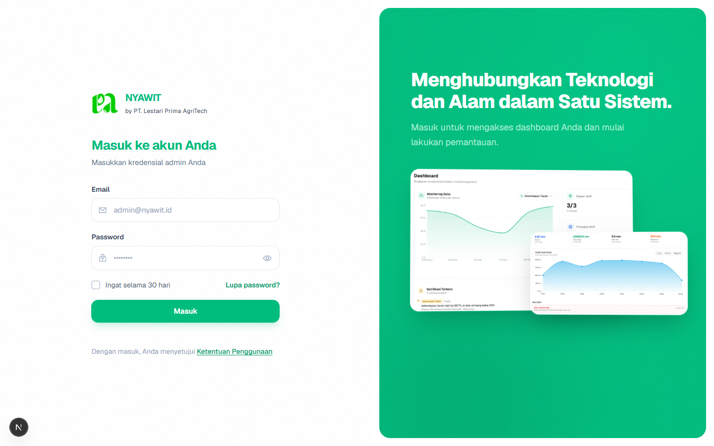
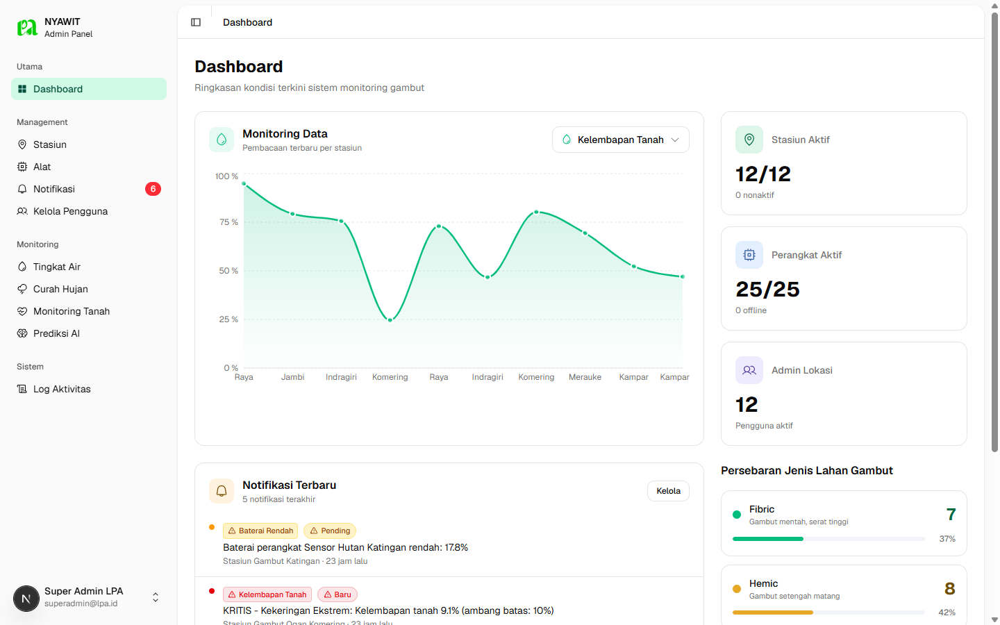
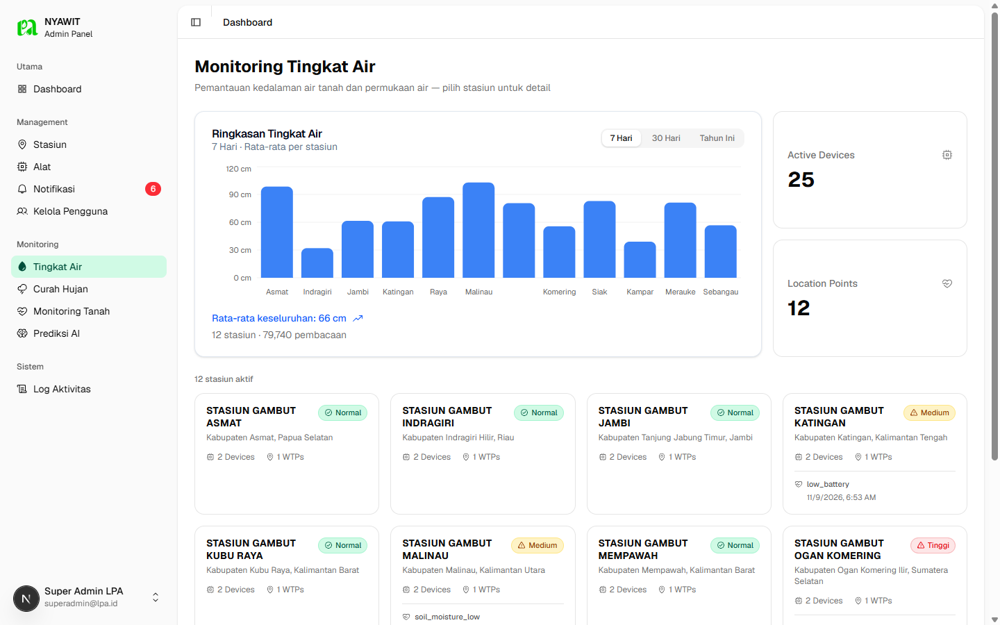
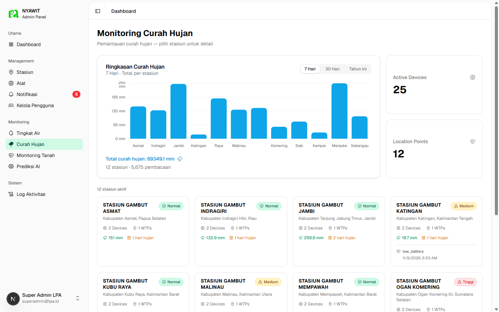
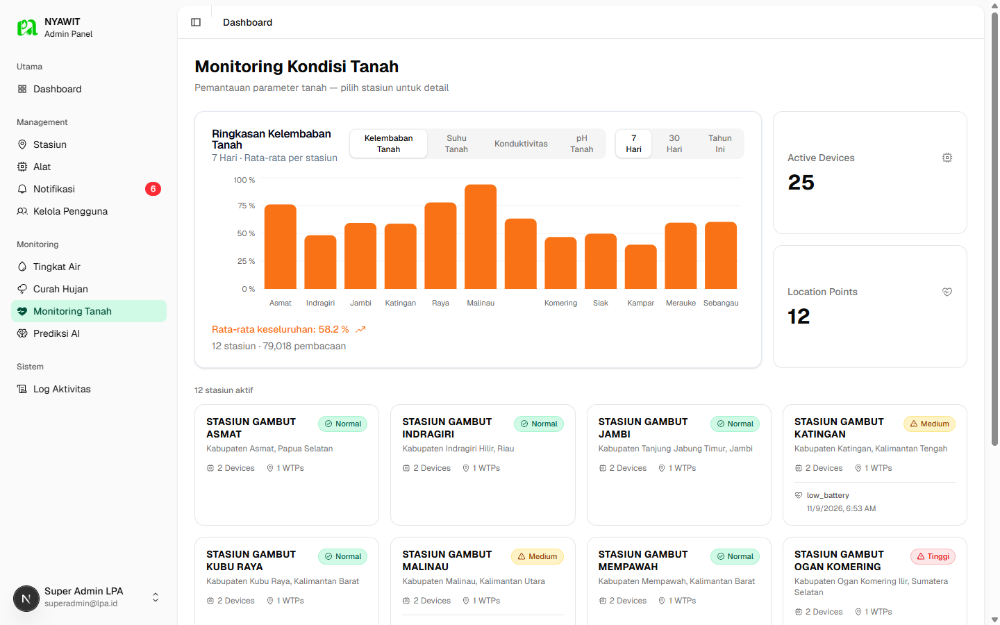
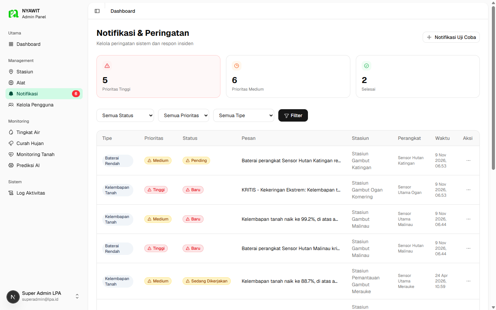
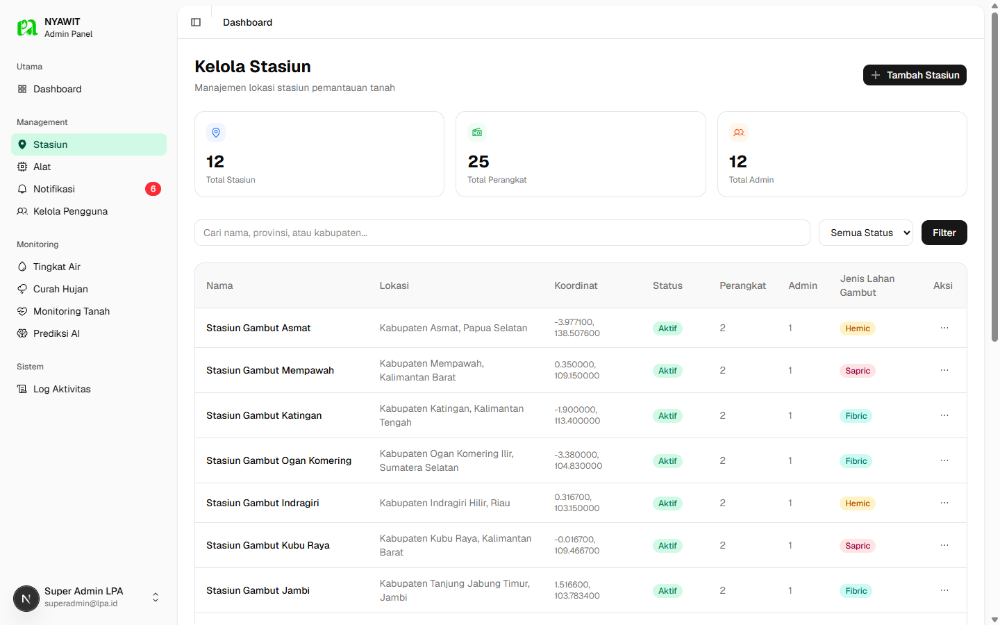
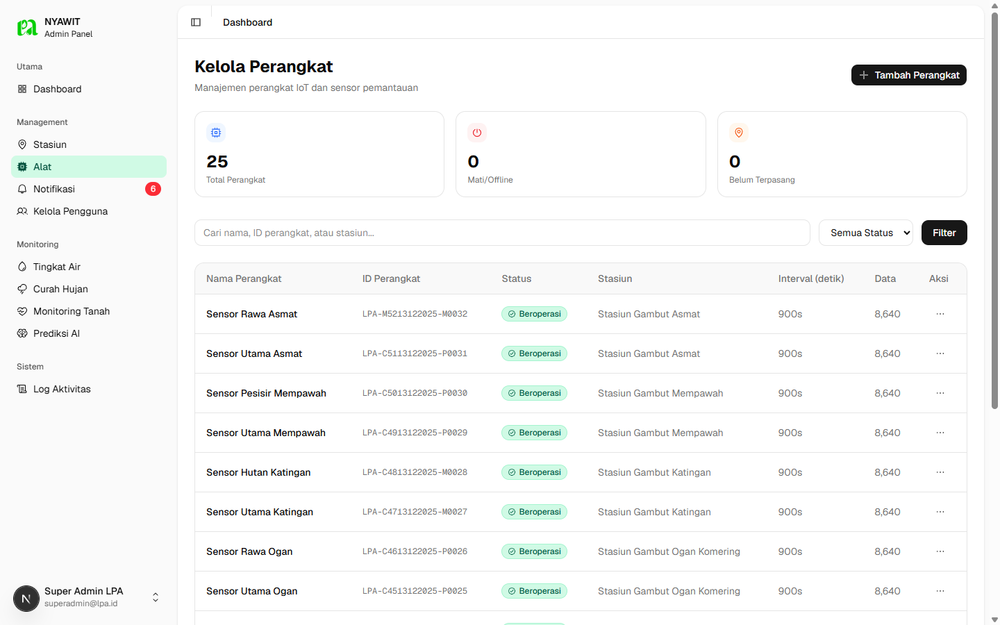
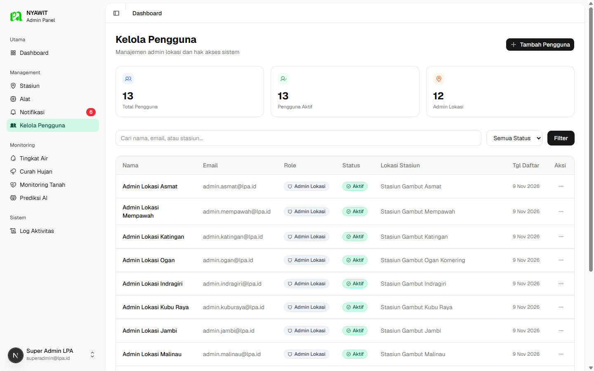

## 2.2.1 Web Application

### A. Halaman Login

Gambar 2.8. Tampilan Halaman Login

Gambar 2.8 merupakan tampilan dari halaman *login* pada *web application* NYAWIT. Halaman ini berisikan *text field* untuk memasukkan *email* dan *password*, *checkbox* untuk opsi "Ingat selama 30 hari", serta *button* "Masuk" untuk mengautentikasi pengguna. Selain itu, terdapat tautan "Lupa password?" di bagian bawah formulir. Di sisi kanan layar terdapat panel hero dengan logo NYAWIT dan pratinjau antarmuka *dashboard*, sehingga pengguna dapat melihat gambaran umum sistem sebelum masuk.

### B. Dashboard

Gambar 2.9. Tampilan Dashboard

Gambar 2.9 merupakan tampilan dari *dashboard* setelah pengguna berhasil melakukan *login* ke dalam sistem. Di bagian atas terdapat tiga *stat card* yang menampilkan jumlah stasiun aktif, perangkat aktif, dan admin lokasi. Selanjutnya terdapat *area chart* "Monitoring Data" yang dapat menampilkan enam parameter berbeda, yaitu kelembapan tanah, suhu tanah, tingkat air, konduktivitas, nilai pH, dan curah hujan, melalui *dropdown* pemilih parameter. Di sisi kanan bawah terdapat tabel "Notifikasi Terbaru" yang menampilkan lima peringatan terakhir beserta prioritas dan statusnya. Terakhir, terdapat kartu "Persebaran Jenis Lahan Gambut" yang menyajikan proporsi tiga jenis gambut, yaitu Fibric, Hemic, dan Sapric, dalam bentuk bilangan dan bilah persentase.

### C. Monitoring Tingkat Air

Gambar 2.10. Tampilan Monitoring Tingkat Air

Gambar 2.10 merupakan tampilan dari menu Monitoring Tingkat Air. Halaman ini menampilkan *bar chart* "Ringkasan Tingkat Air" yang menyajikan rata-rata kedalaman air per stasiun dalam kurun waktu tertentu, dilengkapi dengan tombol pemilih rentang waktu 7 Hari, 30 Hari, dan Tahun Ini. Di samping kanan *chart* terdapat dua *stat card*, yaitu Active Devices dan Location Points. Selanjutnya terdapat daftar stasiun dalam bentuk *grid card* yang menampilkan nama stasiun, lokasi, jumlah perangkat, rata-rata tingkat air, serta indikator status peringatan terakhir jika ada.

### D. Monitoring Curah Hujan

Gambar 2.11. Tampilan Monitoring Curah Hujan

Gambar 2.11 merupakan tampilan dari menu Monitoring Curah Hujan. Pada bagian atas terdapat *bar chart* "Ringkasan Curah Hujan" yang menampilkan total curah hujan per stasiun dengan rentang waktu yang dapat dipilih. Di samping kanan *chart* terdapat *stat card* Active Devices dan Location Points. Selanjutnya terdapat *grid card* stasiun yang memuat informasi nama stasiun, lokasi, jumlah perangkat, total curah hujan, dan jumlah hari hujan. Informasi ini membantu pengguna mengidentifikasi stasiun dengan intensitas hujan tertinggi.

### E. Monitoring Kondisi Tanah

Gambar 2.12. Tampilan Monitoring Kondisi Tanah

Gambar 2.12 merupakan tampilan dari menu Monitoring Kondisi Tanah. Halaman ini menampilkan *bar chart* "Ringkasan" yang dapat menampilkan salah satu dari empat parameter tanah, yaitu Kelembaban Tanah, Suhu Tanah, Konduktivitas, dan pH Tanah. Pemilihan parameter dilakukan melalui serangkaian tombol di samping kanan *chart*. Di samping kanan bagian atas juga terdapat *stat card* Active Devices dan Location Points. Selanjutnya terdapat *grid card* stasiun yang menampilkan nilai rata-rata parameter terpilih beserta informasi lokasi dan status peringatan terkini.

### F. Notifikasi & Peringatan

Gambar 2.13. Tampilan Notifikasi & Peringatan

Gambar 2.13 merupakan tampilan dari menu Notifikasi & Peringatan. Di bagian atas terdapat tiga *stat card* yang menampilkan jumlah peringatan dengan prioritas tinggi, prioritas medium, dan status selesai. Selanjutnya terdapat tiga *dropdown filter* untuk menyaring data berdasarkan status, prioritas, dan tipe peringatan, serta *button* "Filter" dan "Reset". Tabel di bawahnya berisi kolom Tipe, Prioritas, Status, Pesan, Stasiun, Perangkat, Waktu, dan Aksi. Di sudut kanan atas terdapat *button* "Notifikasi Uji Coba" yang dapat digunakan oleh *Super Admin* untuk membuat peringatan simulasi.

### G. Kelola Stasiun

Gambar 2.14. Tampilan Kelola Stasiun

Gambar 2.14 merupakan tampilan dari menu Kelola Stasiun. Halaman ini menampilkan tiga *stat card*, yaitu Total Stasiun, Total Perangkat, dan Total Admin. Di bawahnya terdapat *text field* pencarian dan *dropdown* filter status untuk menyaring data stasiun. Tabel stasiun memuat kolom Nama, Lokasi, Koordinat, Status, Perangkat, Admin, Jenis Lahan Gambut, dan Aksi. Di sudut kanan atas terdapat *button* untuk menambahkan stasiun baru. Halaman ini digunakan oleh *Super Admin* untuk mengelola lokasi pemantauan yang terdaftar dalam sistem.

### H. Kelola Perangkat

Gambar 2.15. Tampilan Kelola Perangkat

Gambar 2.15 merupakan tampilan dari menu Kelola Perangkat. Bagian atas terdapat tiga *stat card*, yaitu Total Perangkat, Mati/Offline, dan Belum Terpasang. Di bawahnya terdapat *text field* pencarian dan *dropdown* filter status. Tabel perangkat memuat kolom Nama Perangkat, ID Perangkat, Status, Stasiun, Interval (detik), Data, dan Aksi. Kolom Data menampilkan jumlah pembacaan yang telah diterima dan status ketersediaan data terbaru. Halaman ini digunakan untuk mengelola perangkat IoT dan sensor pemantauan yang terhubung dengan sistem NYAWIT.

### I. Kelola Pengguna

Gambar 2.16. Tampilan Kelola Pengguna

Gambar 2.16 merupakan tampilan dari menu Kelola Pengguna. Halaman ini menampilkan tiga *stat card*, yaitu Total Pengguna, Pengguna Aktif, dan Admin Lokasi. Di bawahnya terdapat *text field* pencarian dan *dropdown* filter status. Tabel pengguna memuat kolom Nama, Email, Role, Status, Lokasi Stasiun, Tanggal Daftar, dan Aksi. Halaman ini digunakan oleh *Super Admin* untuk mengelola akun *admin* lokasi, termasuk penambahan, pengubahan, dan penonaktifan pengguna sesuai dengan stasiun yang menjadi tanggung jawabnya.
